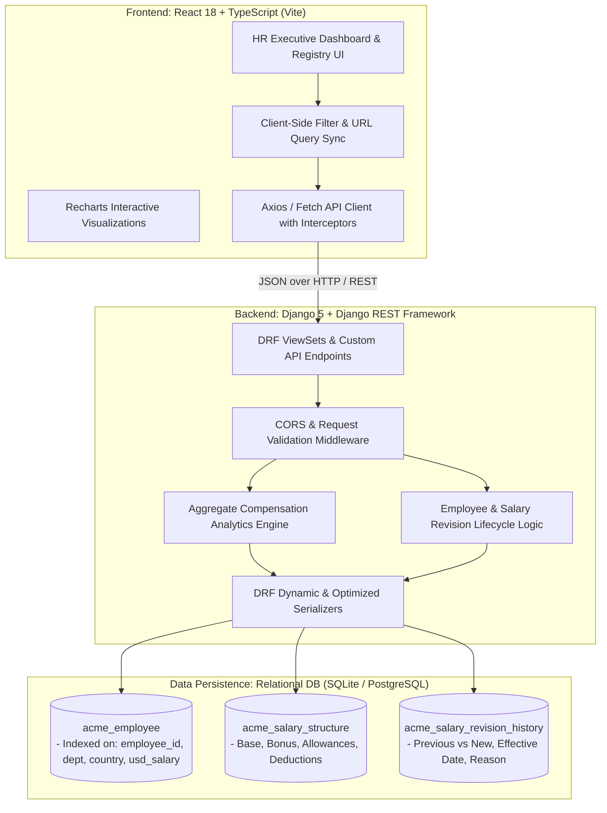
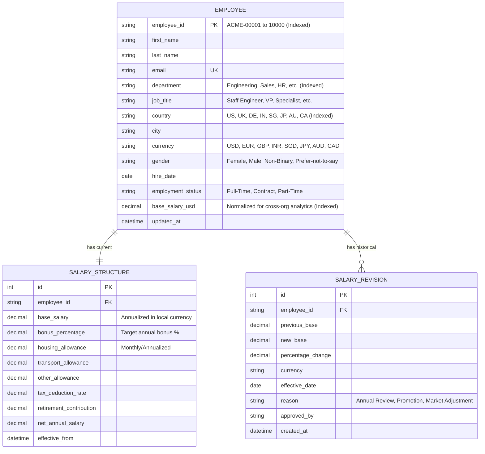

# System Architecture & Technical Design Document
## ACME Salary Management System (Scale: 10,000 Employees)

### 1. High-Level Architecture Overview



---

### 2. Entity-Relationship Data Model



---

### 3. Sub-Second Performance Strategy for 10,000 Employees

Handling 10,000 records smoothly in a web application requires specific optimizations across the database, server, and client:

1. **Database Indexing Strategy:**
   - B-Tree compound index on `(department, country)` for rapid faceted slicing.
   - Compound index on `(country, base_salary_usd)` for regional pay parity checks.
   - Dedicated index on `employee_id` and `email` for \(O(1)\) lookups.
   - Normalized `base_salary_usd` computed at write time, eliminating on-the-fly currency conversions during aggregate queries.

2. **Server-Side Aggregations (Zero Python Loop Overhead):**
   - Django ORM handles all math natively inside the SQL query engine:
     ```python
     aggregates = Employee.objects.aggregate(
         total_spend_usd=Sum('base_salary_usd'),
         avg_salary_usd=Avg('base_salary_usd'),
         min_salary_usd=Min('base_salary_usd'),
         max_salary_usd=Max('base_salary_usd'),
         headcount=Count('id')
     )
     ```
   - Eliminates loading 10,000 objects into Python memory.

3. **Server-Side Pagination:**
   - Standard page sizes of 25, 50, 100 with `SQL LIMIT` and `OFFSET`.
   - Payload size per request is kept under 50KB, ensuring snappy mobile and desktop responsiveness.

4. **Frontend Virtualization & Debounced Search:**
   - Keystroke search queries are debounced (300ms) before querying the backend.
   - Responsive loading skeletons prevent layout shift while data fetches asynchronously.

---

### 4. RESTful API Endpoints Contract

| Method | Endpoint | Description |
| :--- | :--- | :--- |
| `GET` | `/api/analytics/summary/` | Global KPIs: Total spend (USD), avg, median, headcount, by currency |
| `GET` | `/api/analytics/departments/` | Departmental spend, avg salary, headcount breakdown |
| `GET` | `/api/analytics/geo/` | Country-by-country compensation & headcount distribution |
| `GET` | `/api/analytics/pay-parity/` | Gender pay gap metrics & salary band distributions |
| `GET` | `/api/employees/` | Paginated employee list with filters (`department`, `country`, `search`, `min_salary`, etc.) |
| `GET` | `/api/employees/{id}/` | Detailed employee record with current salary & revision history |
| `POST` | `/api/employees/` | Create a new employee with initial salary structure |
| `POST` | `/api/employees/{id}/revise-salary/` | Record a salary revision with reason and approval log |
| `GET` | `/api/employees/export-csv/` | Stream filtered dataset to CSV |
| `GET` | `/api/currencies/` | Supported currencies & exchange rate matrix |
| `GET` | `/api/health/` | Health check for Docker / orchestrator |
